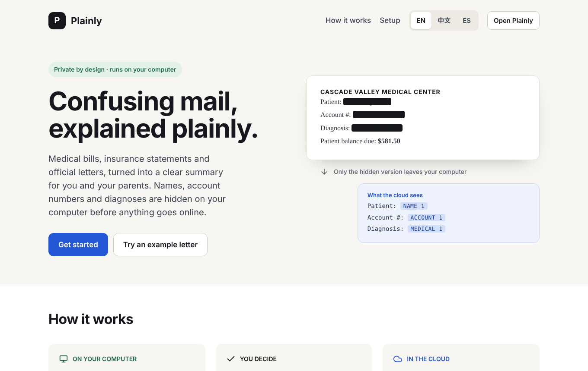
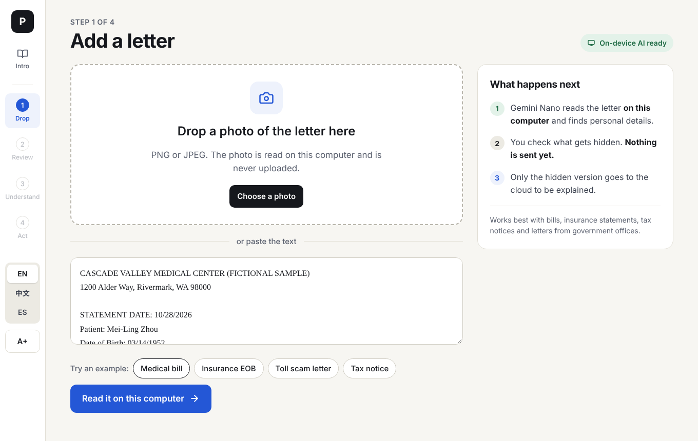
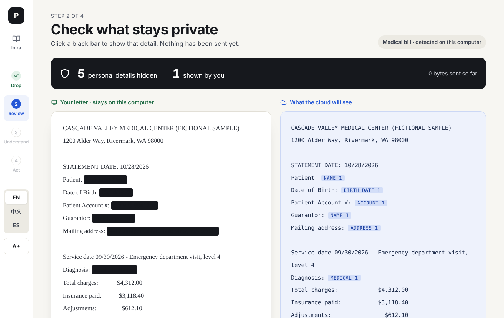
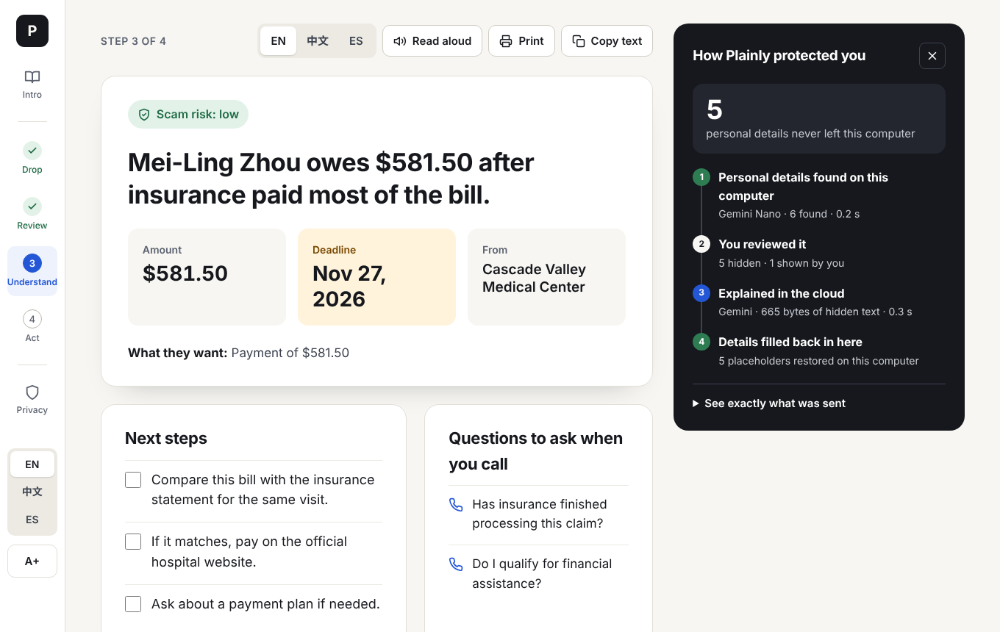
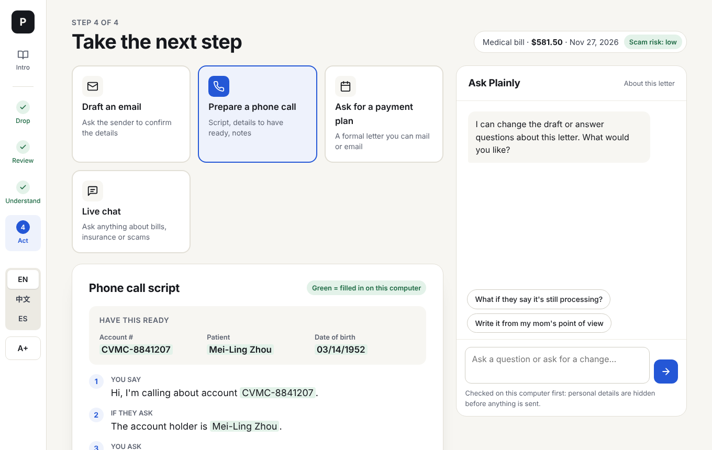
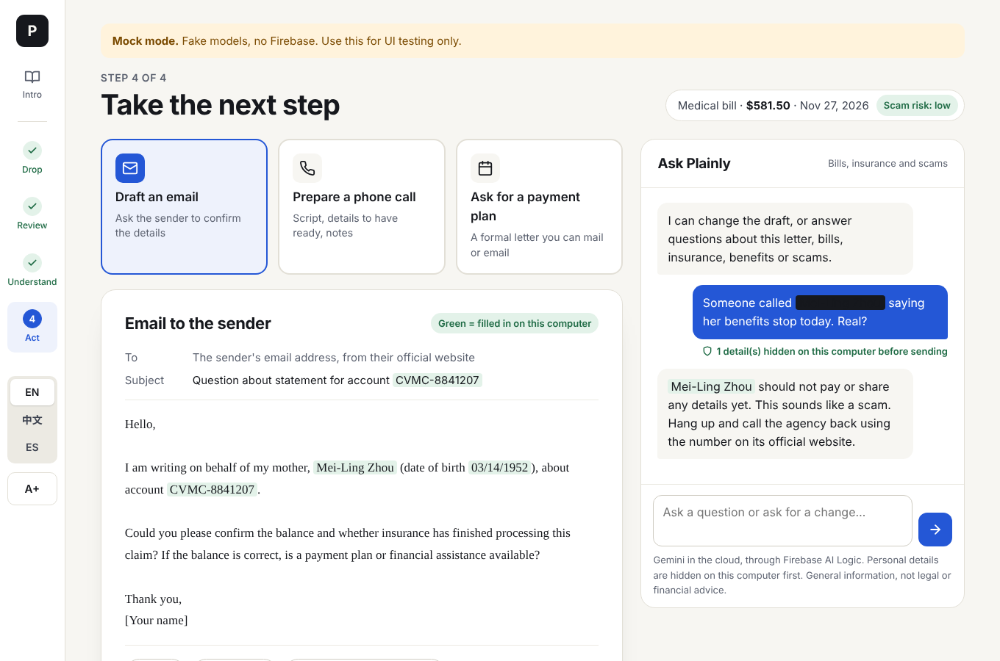

# Plainly

**Confusing mail, explained plainly.**

Plainly turns medical bills, insurance statements and official letters into a clear, plain-language summary for you and your family, in English, 中文 or Español. Names, account numbers and diagnoses are hidden **on your own computer** before anything goes online.

- **Try it:** <https://plainly-d0fa3.web.app>
- **Try it without any setup** (example data, works in any browser): <https://plainly-d0fa3.web.app/?mock>
- **Demo video:** <https://youtu.be/FkfFvpsMw_o>

---

## Contents

- [What Plainly does](#what-plainly-does)
- [How your privacy is protected](#how-your-privacy-is-protected)
- [What you need](#what-you-need)
- [Using Plainly, step by step](#using-plainly-step-by-step)
- [Languages and accessibility](#languages-and-accessibility)
- [Troubleshooting](#troubleshooting)
- [Frequently asked questions](#frequently-asked-questions)
- [Important to know](#important-to-know)
- [For developers](#for-developers)

---

## What Plainly does

Many families get letters that are hard to read: a hospital bill, an insurance "Explanation of Benefits", a tax notice, a toll notice that might be a scam. Often an adult child ends up sorting out a parent's mail. Plainly helps you:

- **Understand it:** a one-line summary, the amount, the deadline and who sent it.
- **Spot scams:** a scam-risk rating, with the warning signs found in the letter.
- **Know what to do next:** a checklist of next steps and questions to ask when you call.
- **Take action:** a ready-to-send email, a phone-call script, a payment-plan letter, or steps to report a scam.
- **Ask questions:** a chat about the letter, plus an open chat about bills, insurance, benefits and scams.

## How your privacy is protected

Plainly is built so that your personal details stay on your computer.

1. **Your letter is read on your computer.** Gemini Nano, the AI built into Google Chrome, finds names, addresses, dates of birth, account numbers and medical details. Photos of your letter never leave your computer.
2. **You decide what is hidden.** Personal details become black bars. You can show any of them again, or highlight more text to hide.
3. **Only the hidden version goes online.** Gemini in the cloud sees labels like `NAME 1` and `ACCOUNT 1`, never the real values.
4. **Real details are filled back in on your computer**, in the explanation, the drafts and the chat replies.

| | Stays on your computer | Sent to the cloud |
|---|---|---|
| Photo of the letter | ✔ | Never |
| Names, addresses, dates of birth, account and ID numbers, diagnoses | ✔ | Only as labels such as `NAME 1` |
| Anything you show on purpose (click a black bar) | ✔ | Yes, because you chose to show it |
| What you type in a chat | ✔ (checked first) | After personal details are hidden |

**Nothing is saved.** Plainly has no accounts. Your letter, drafts and chats exist only in the open browser tab and are gone when you close it. The only things Plainly remembers, in your browser, are your language, your text size and whether you've seen the intro.

After each explanation, the **How Plainly protected you** panel shows exactly what ran on your computer, what went to the cloud, and the exact text that was sent.

## What you need

- **A desktop or laptop computer with a recent version of Google Chrome.**
- **Chrome's on-device AI.** The first time, Plainly downloads it for you (a large, one-time download). It needs a reasonably powerful computer; the intro page tells you whether yours qualifies.
- **An internet connection** for the explanation, drafts and chats.

**On a phone, or a computer without on-device AI?** Plainly still works, with limits:
- You can't add letters by photo, because Plainly never uploads them. Paste the text instead.
- Only numbers and IDs are hidden automatically. Highlight names, addresses and medical details yourself before sending.

## Using Plainly, step by step

### 1. Add a letter

- **Drop a photo** of the letter (PNG or JPEG), or **paste its text**.
- Want to see how it works first? Click one of the **example letters**. They are made-up letters, not real people.
- Click **Read it on this computer**. A status line shows what's happening.

### 2. Check what stays private

- On the left is your letter with personal details covered by **black bars**. On the right is **exactly what the cloud will see**.
- **Click a black bar** to show that detail, for example a customer-service phone number you don't mind sharing. Click again to hide it.
- **Missed something?** Highlight it in your letter, choose what kind of detail it is, and click **Hide selection**.
- If Plainly sees signs of a scam, a red warning appears here, before anything is sent.
- When you're happy, click **Send the hidden version**.

### 3. Understand the letter

- A **scam-risk** rating, a one-line **summary**, and the **amount**, **deadline** and **sender**.
- **Next steps** you can tick off, and **questions to ask** when you call.
- **Read aloud**, **Print** (a clean page to hand to a parent) and **Copy text** (to paste into a message).
- The dark **How Plainly protected you** panel lists every step and where it ran.

### 4. Take the next step

Click **Take the next step** and choose an action:

- **Draft an email:** a polite email to the sender, with your details filled in. Use **Open in email app** or **Copy**.
- **Prepare a phone call:** the details to have ready, a short script (with a translation if you use 中文 or Español), and space for notes. For low-risk letters, a **Call** button dials the number from the letter.
- **Ask for a payment plan:** a formal letter. Enter what you can pay per month and click **Update letter**, then **Print**.
- **For a suspected scam,** the choices change to **Report the scam** (steps to stay safe and report it) and a call script for checking with the *real* organization. Plainly won't offer to call a number from a suspicious letter.

Every draft can be adjusted with **Shorter**, **More formal** or **Mention financial hardship**, or edited by hand with **Edit**. Text in green was filled in on your computer.

**Ask Plainly**, on the right, is a chat with Gemini. It can change the draft for you ("add a line asking about a discount"), explain the letter, and answer general questions about bills, insurance, benefits and scams ("Is this phone call a scam?"). Names, numbers and other personal details you type are hidden on your computer before the message is sent; ordinary questions go through as written.

In both chats, anything you type is checked on your computer first. If you type a name or a number, it becomes a black bar and a green note says it was hidden before sending.

## Languages and accessibility

- **English, 中文 and Español.** Use the **EN / 中文 / ES** switch in the left toolbar (or on the intro page). It changes the whole app and the explanation, and Plainly remembers your choice.
- **Emails and letters to US organizations are always written in English**, with an explanation in your language so you know what you're sending.
- **Bigger text:** click **A+** in the toolbar.
- **Read aloud** on the explanation page, in the chosen language.
- Designed to work with screen readers and keyboard navigation. Animations slow down or stop if "reduce motion" is turned on on your computer.

## Troubleshooting

| You see | What it means | What to do |
|---|---|---|
| **Needs a one-time download** (intro page) | Chrome's on-device AI isn't downloaded yet | Click **Download on-device AI** and wait for it to finish |
| **Not supported on this computer** | This computer can't run Chrome's on-device AI | Use Plainly with pasted text and hide names yourself, or use another computer |
| **Turn on the Prompt API in Chrome** | Chrome's on-device AI is switched off | Update Chrome; see [Developer guide](docs/DEVELOPMENT.md#1-chrome) for the setting |
| *"The photo was not uploaded"* | No on-device AI to read the photo privately | Paste the letter's text instead |
| *"The cloud explanation didn't work…"* | The cloud didn't answer | You still get a short English summary written on your computer. Try again later for the full explanation |
| **Still working… 20 s** | The cloud is slow | Wait a little longer, or check your internet connection |

## Frequently asked questions

**Is Plainly free?** Yes.

**Does Plainly keep my letters?** No. There are no accounts and nothing is stored. Closing the tab clears everything.

**Can Plainly call the hospital or insurer for me?** No. Plainly prepares the call: what to say, what to have ready and what to ask. You or your family make the call.

**Which letters work best?** Medical bills, insurance statements (EOBs), tax notices, utility or toll notices, and letters from government offices, in English.

**What is the `?mock` link?** A demo mode with example data and simulated AI. Use it to try Plainly on any browser without setup. Don't use it for real letters.

## Important to know

- Plainly gives **general information, not legal, medical or financial advice**. For decisions about money, benefits or health, check with the organization or a qualified professional.
- **If a letter or call might be a scam, don't use the phone number, link or address in it.** Contact the organization using its official website or the number on your card.
- AI can make mistakes. Always check amounts and dates against the original letter.

## For developers

Plainly is a React web app built with **Firebase AI Logic hybrid inference**: Gemini Nano runs in Chrome on the user's computer for reading the letter and hiding personal details, and Gemini in the cloud writes the explanations, drafts and chat replies from the hidden version only.

Setup, testing, deployment, architecture and the code map are in the **[Developer guide](docs/DEVELOPMENT.md)**.

## License

Apache License 2.0. See [LICENSE](LICENSE).

The example letters in this project are fictional. Any resemblance to real people, organizations or accounts is coincidental.
